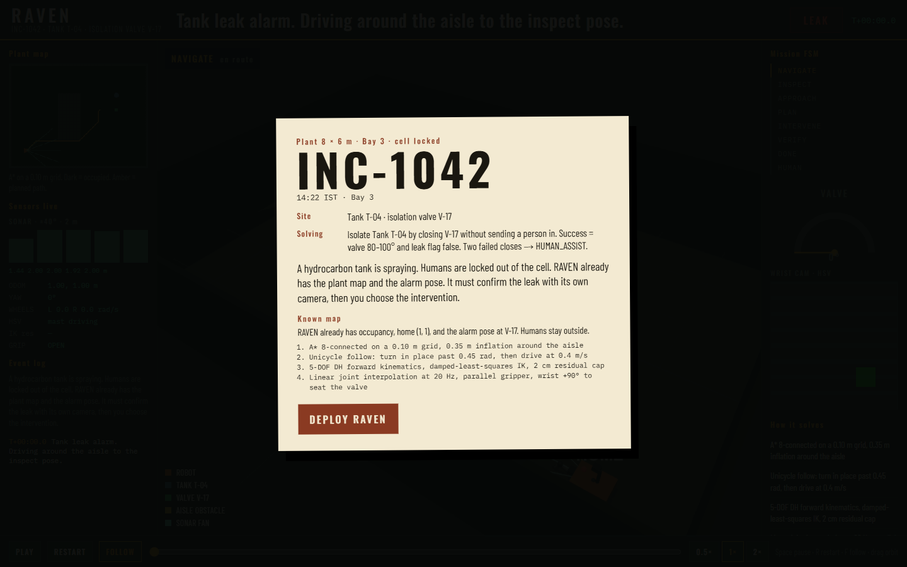
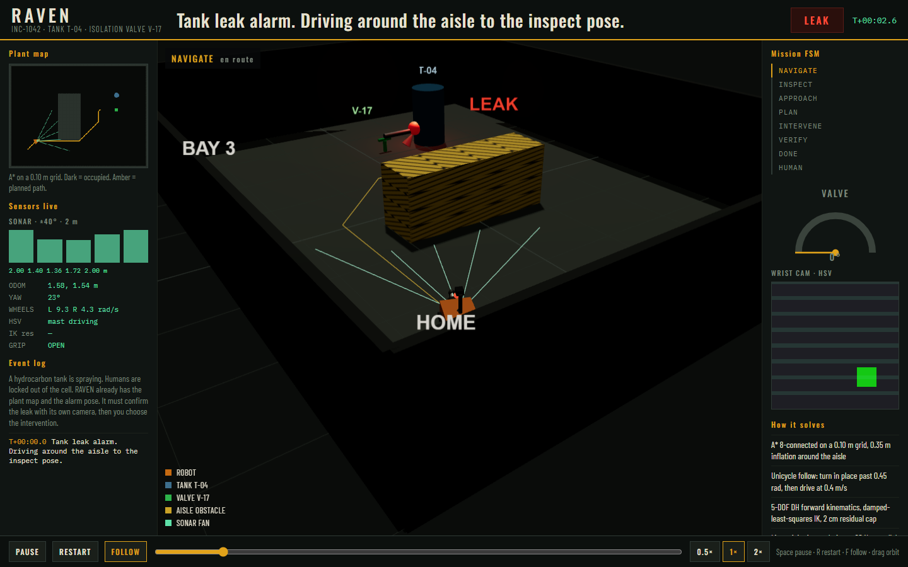
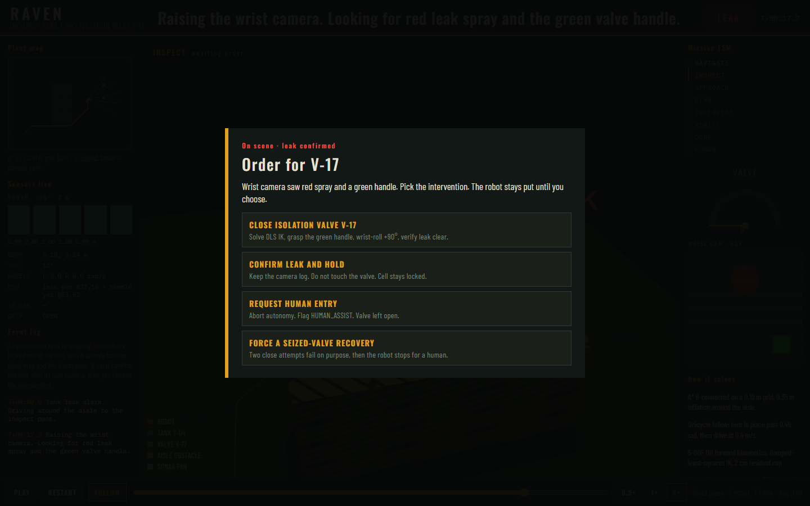
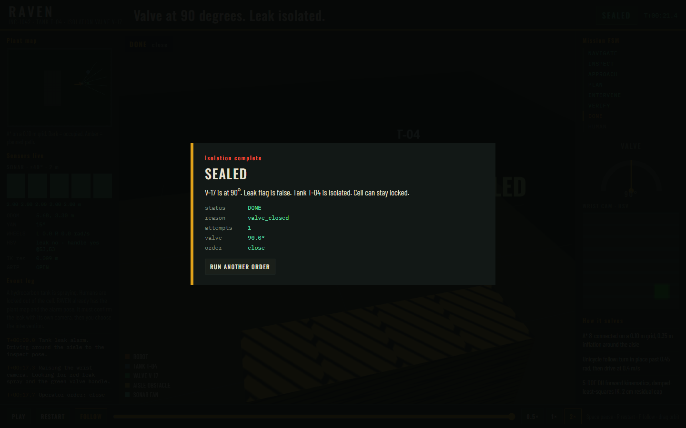

# RAVEN

**Robotic Autonomous Verification & Emergency Navigation**

Simulation-only industrial leak isolation for **SRM 21MEO106T Introduction to Robotics**. Python 3.13. No hardware. A tank in Bay 3 is spraying. Humans are locked out. RAVEN already has the plant map and the alarm pose. It drives there, confirms the leak with its own camera, then you choose the intervention.



## What this repo is

A working plant + mobile manipulator + sensors + mission brain, with a **live browser control room**.

| You get | You do not get |
|---|---|
| 8×6 m plant, occupancy grid, A* | Real robot / ROS / hardware |
| Differential-drive base + 5-DOF arm | Multi-robot or multi-valve missions |
| OpenCV HSV leak + handle inspect | Learned / RL policies |
| DH FK, damped-least-squares IK | Return-to-home after success |
| Valve close, verify, human-assist | Replacing the 10-point course brief |
| Story-mode control room at `:8765` | |

## Watch the simulation

```bat
pip install -r requirements.txt
python -m raven
```

Leave the terminal open. Browser: **http://127.0.0.1:8765/**

1. Read ticket **INC-1042** (14:22 IST, Bay 3, Tank T-04, valve V-17). Click **Deploy RAVEN**.
2. Robot A*s around the aisle. Watch the occupancy map, five sonar rays, odometry, wheel speeds.
3. Wrist camera HSV-confirms red spray and the green handle. Playback **stops**.
4. Pick an on-scene order:
   - **Close isolation valve V-17** — IK, grasp, wrist +90°, verify leak clear
   - **Confirm leak and hold** — evidence only, valve left open
   - **Request human entry** — `HUMAN_ASSIST`, cell stays locked
   - **Force a seized-valve recovery** — two failed closes, then human
5. Debrief prints status, reason, attempts, valve angle.







```bat
python -m raven --no-view          :: headless, prints DONE / HUMAN_ASSIST
python -m raven --fail-valve --no-view
python -m raven --port 8765
python -m raven --backend coppelia :: optional CoppeliaSim Edu window
```

`Ctrl+C` in the terminal stops the control room. Space pauses, R restarts, F follow-cam, drag to orbit.

## What we are solving

Isolate Tank T-04 by closing **V-17** without sending a person into the cell.

- Success: valve encoder in **80–100°** and leak flag **false** → `DONE` / `valve_closed`
- Two failed closes → `HUMAN_ASSIST` / `valve_not_closed`
- Camera never sees the leak while the plant is still leaking → `HUMAN_ASSIST` / `no_leak_in_view`

## Sensors and outputs

| Sensor | Use | Output you see in the control room |
|---|---|---|
| Wheel odometry | Dead-reckon pose from left/right wheel speeds, 0.30 m track | `x, y` metres, yaw degrees, 20 Hz |
| Five forward sonars | Occupancy raycast, ±40° fan, 2 m max, 0.08 m steps | Five ranges in metres + 3D fan |
| Wrist RGB camera | OpenCV HSV: red spray = leak, green blob = handle | `leak_seen`, `handle_seen`, pixel centroids |
| Valve encoder | Handle angle after the wrist roll | Degrees (closed band 80–100) |
| Leak flag | Plant ground truth used only in **VERIFY** | true / false LED |

## How the robot does it

1. **NAVIGATE** — 8-connected A* on a 0.10 m grid, 0.35 m inflation around the aisle. Unicycle follow (turn in place past 0.45 rad, then 0.4 m/s).
2. **INSPECT** — raise wrist, HSV inspect. This is the story **decision gate**.
3. **APPROACH** — roll in to arm reach (standoff 0.42 m).
4. **PLAN** — 5-DOF DH forward kinematics, damped-least-squares IK, 2 cm residual cap.
5. **INTERVENE** — linear joint interpolation at 20 Hz, parallel gripper, wrist +90°.
6. **VERIFY** — encoder + leak flag. Retry once, then human.

Plant: 8.0 m × 6.0 m. Home `(1, 1)`. Obstacle `(3.5, 3.0)` 0.6×2.0 m. Tank T-04 `(6.2, 4.2)`. Valve V-17 `(6.2, 3.35)`, handle height 0.25 m.

## What is in this repo

```
raven/
  __main__.py              CLI (mock default, optional Coppelia)
  config.py                all numeric constants
  types.py                 Pose2D, MissionResult, InspectResult
  plant.py                 occupancy grid + named poses
  mission.py               FSM + after-inspect policies
  nav/astar.py             8-connected A*
  nav/controller.py        unicycle wheel speeds
  nav/range.py             five sonar rays
  arm/dh.py                homogeneous FK
  arm/ik.py                damped least squares
  arm/motion.py            20 Hz joint interpolation
  vision/inspect.py        HSV leak + handle
  backends/base.py         RobotBackend protocol
  backends/mock.py         MockWorld backend
  backends/coppelia.py     ZeroMQ :23000
  sim/mock_world.py        kinematics, valve physics, synthetic camera
  sim/scene_builder.py     Coppelia primitives if the scene is empty
  sim/recorder.py          20 Hz mission tape (pose, arm, sonars, HSV)
  sim/story.py             INC-1042 briefing + four on-scene branches
  sim/studio.py            HTTP control room
  sim/frames.py            plant (x,y,z) → Three.js (x,z,y)
  web/                     Three.js control room (ticket, map, 3D, orders)
tests/                     pytest, including headless --no-view
docs/superpowers/specs/    design spec
docs/superpowers/plans/    implementation plan
docs/superpowers/proof/    control-room screenshots
requirements.txt
README.md
```

The course handout spreadsheet stays on disk untracked. Do not replace the 10-point brief; this repo is the working demo.

`RobotBackend` (both mock and Coppelia implement the same methods):

`get_pose`, `set_wheel_speeds`, `get_joints` / `set_joint_targets`, `set_gripper`, `get_camera_rgb`, `get_leak`, `get_valve_angle`, `step`, `close`.

## Tests

```bat
python -m pytest tests -q
```

Covers A*, DH/IK, vision, FSM, mock mission, sonar rays, story branches, and the HTTP control room. `--no-view` is the headless path tests use.

## CoppeliaSim Edu (optional)

The browser control room is enough to mark the demo. Coppelia is a second 3D window, same mission brain.

1. Install CoppeliaSim Edu.
2. `pip install coppeliasim-zmqremoteapi-client`
3. In Coppelia: **Add-ons → ZMQ remote API server** (port 23000).
4. `python -m raven --backend coppelia`

If Coppelia is already open, dismiss first-run windows, then start the ZMQ add-on.

## Course

**21MEO106T Introduction to Robotics**, ODD 2026–2027. Dual-stack so the internals (planning, kinematics, vision, FSM) run without the GUI, and the control room is what you show.
